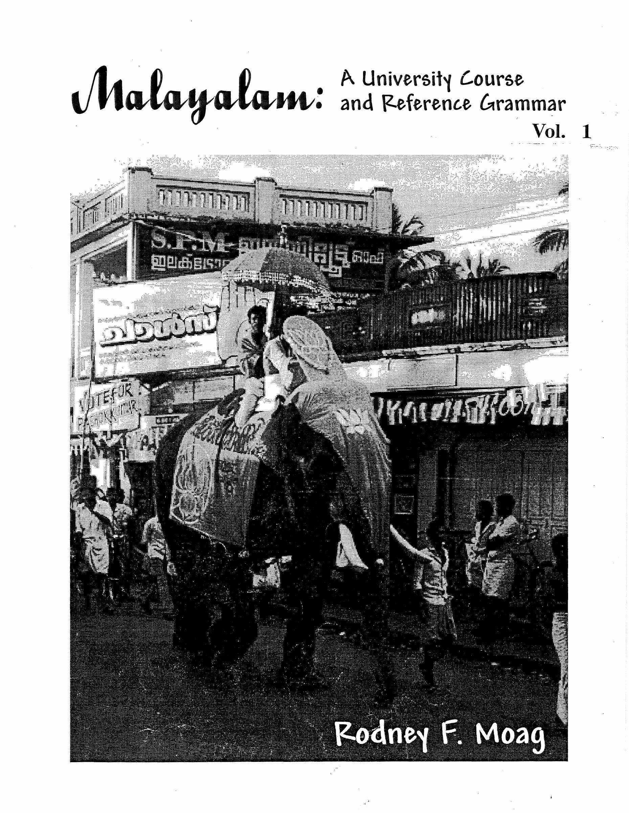

<!-- reading-anchor -->
# Front Matter

<!-- Source: PDF page 1; printed page unnumbered. -->

The University of Texas at Austin  
South Asia Institute

<!-- reading-anchor -->
## Open Educational Resources for South Asian Language Instruction

Language: Malayalam

Malayalam: A University Course and Reference Grammar by Rodney F. Moag is licensed under a [Creative Commons Attribution-NonCommercial-ShareAlike 4.0 International License](https://creativecommons.org/licenses/by-nc-sa/4.0/).

This work is normally printed in two volumes (the second volume beginning with Lesson 17), but the source PDF presents it in a single document. This digital edition divides it into linked chapters.

Created in cooperation with the Center for Open Educational Resources and Language Learning.

Last updated: April 2018  
Rodney F. Moag  
Professor Emeritus  
University of Texas at Austin

<!-- Source: PDF page 2; printed page unnumbered. -->

<!-- reading-anchor -->
## Malayalam: A University Course and Reference Grammar

Vol. 1

Rodney F. Moag

<!-- Source: PDF page 3; printed page unnumbered. -->

<!-- reading-anchor -->
## Malayalam: A University Course and Reference Grammar

Fourth Edition

Rodney F. Moag

Published by The Center for Asian Studies  
The University of Texas at Austin  
Spring, 2002

<!-- Source: PDF page 4; printed page unnumbered. -->

<!-- Blank source page. -->

<!-- Source: PDF page 5; printed page unnumbered. -->

<!-- Source: PDF page 6; printed page unnumbered. -->
<!-- Source: PDF page 7; printed page unnumbered. -->
<!-- Source: PDF page 8; printed page unnumbered. -->
<!-- Source: PDF page 9; printed page unnumbered. -->
<!-- Source: PDF page 10; printed page unnumbered. -->

<!-- reading-navigation -->

---

[Contents](contents.md) · [Next: Acknowledgements →](acknowledgments.md)

<!-- /reading-navigation -->
